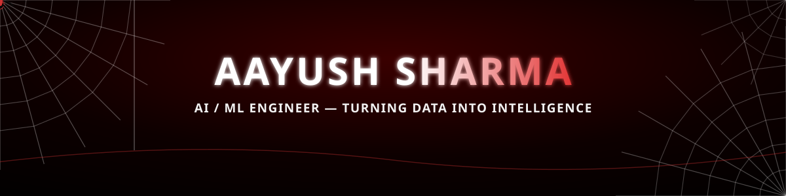

<div align="center">

<!-- ANIMATED SPIDER-WEB HERO (SMIL) -->


<!-- NAME BANNER WITH FADE-IN -->


<!-- TYPING ANIMATION -->


<br>

<p align="center">
  
  &nbsp;
  
  &nbsp;
  
</p>

</div>


## 🕸️ About

<table align="center">
<tr>
<td valign="top" width="58%">

```yaml
role:               Graduate Trainee (AI/ML Backend Developer) @ Ambrosial Nutrifood
education:          B.Tech Information Technology · Class of 2026
                    Chandigarh Engineering College, Landran
focus:              LLM Applications · RAG Pipelines · Multi-Agent Systems
currently_learning: Advanced RAG Architectures · Agentic Workflows
open_to:            AI/ML · Data Science · Data Analytics (Entry-Level)
collaborate_on:     GenAI & LLM-powered applications
seeking_guidance:   Deploying ML / GenAI systems to production
```

🎓 **IBM** — Data Analysis with Python &nbsp;·&nbsp; **Infosys Springboard**
📫 **aayushgamer702@gmail.com**

</td>
<td valign="top" width="42%" align="center">

### ⚡ Featured Build

<a href="https://college-assistant-ei4i2rzqjfkdbyrodzftp8.streamlit.app/">

</a>

<br><br>


</td>
</tr>
</table>


## 🚀 Selected Projects

<table align="center">
<tr>
<td width="50%" valign="top">

**🎓 College Assistant Chatbot**
Deployed conversational assistant for college queries — live on Streamlit Cloud.
`LangChain` `RAG` `Streamlit`

</td>
<td width="50%" valign="top">

**🩺 MedoraAI**
Flagship healthcare prediction app with an interactive Streamlit interface.
`Scikit-learn` `XGBoost` `Streamlit`

</td>
</tr>
<tr>
<td width="50%" valign="top">

**🏙️ AuraCity**
City assistant built as a stateful, multi-step agent workflow.
`LangGraph` `LLMs`

</td>
<td width="50%" valign="top">

**✍️ Byline Desk**
LinkedIn post pipeline with a writer–reviewer agent loop and live web search.
`LangGraph` `Mistral` `Gemini` `Tavily`

</td>
</tr>
<tr>
<td width="50%" valign="top">

**🔬 ResearchMind**
Multi-agent research pipeline that plans, gathers and synthesizes findings.
`Multi-Agent` `LangGraph`

</td>
<td width="50%" valign="top">

**📄 RAG PDF Assistant**
Document Q&A grounded in your own PDFs using semantic retrieval.
`FAISS` `HuggingFace` `RAG`

</td>
</tr>
<tr>
<td width="50%" valign="top">

**🤖 Zeno AI**
Fast conversational agent with persistent session memory.
`LangGraph` `Groq`

</td>
<td width="50%" valign="top">

**🌸 WordBloom**
LSTM-based next-word prediction model.
`TensorFlow` `LSTM`

</td>
</tr>
</table>

<div align="center">
<a href="https://github.com/Aayush20art?tab=repositories">

</a>
</div>


<div align="center">

## 🛠️ Tech Arsenal

**Languages & Core**


**ML & Data**


**GenAI & Tooling**


</div>


<div align="center">

## 📊 GitHub Analytics


&nbsp;


<br>


</div>


<div align="center">

## 🐍 Contribution Graph


<sub>Auto-regenerates daily via GitHub Actions.</sub>

</div>


<div align="center">

## 🌐 Let's Connect

<a href="https://linkedin.com/in/aayush-sharma-b108a93b0" target="_blank">
  
</a>
<a href="mailto:aayushgamer702@gmail.com">
  
</a>
<a href="https://github.com/Aayush20art" target="_blank">
  
</a>

<br><br>


</div>


